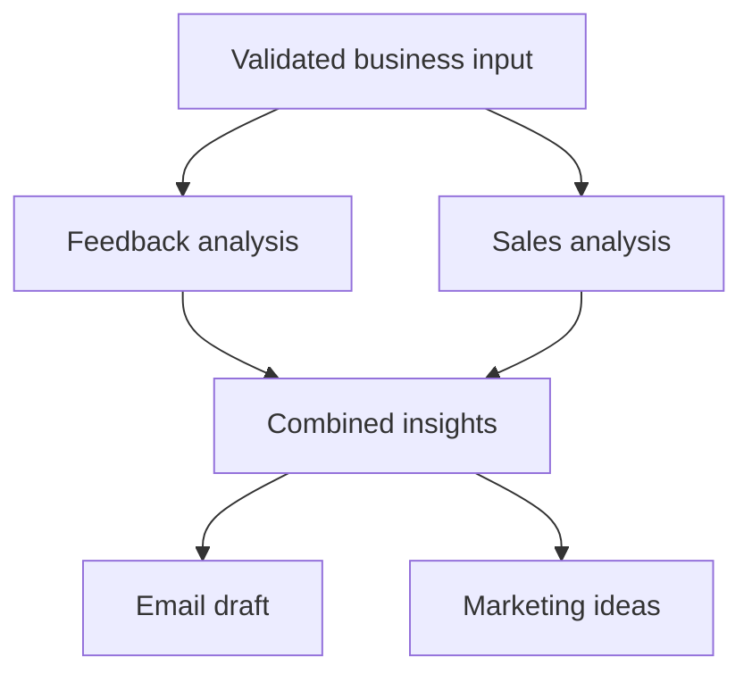

# InsightWeaver · LangGraph business analysis

A structured five-stage workflow that turns customer feedback and sales observations into an analysis, an email draft and marketing ideas.

[](https://github.com/Almizan-khan/insightweaver-agent/actions/workflows/checks.yml)


## Workflow



Independent analyses run in parallel. The synthesis waits for both branches; email and marketing generation then run in parallel. Each stage returns a validated Pydantic schema and a separate timing/token-usage event. One request invokes the graph once. Emails are returned as drafts; the application has no sending capability.

## Run the offline demo

Use Python 3.11:

```bash
python -m venv .venv
source .venv/bin/activate
python -m pip install -r requirements.txt
python run.py --mode offline --output outputs/report.json
python agentpractice4.py
```

The Gradio interface binds to `127.0.0.1`. Offline mode uses **fixed, clearly labeled fixture responses** to demonstrate orchestration and output structure. It does not analyze newly entered business data and makes no model/API calls.

## Connect a live provider

```bash
cp .env.example .env
python run.py --mode live --input examples/input.json --output outputs/live-report.json
```

Set `OPENAI_API_KEY` in `.env`; optionally change `OPENAI_MODEL`. For the UI, also set `INSIGHTWEAVER_MODE=live`, then run `python agentpractice4.py`. Live requests send the supplied text to the configured provider and may incur API charges. Use sample data for demonstrations.

The live adapter enforces structured output, a request timeout and bounded provider retries. Failures propagate instead of being replaced by fabricated analysis. Input text is treated as untrusted data. Prompt instructions are a mitigation, not proof of prompt-injection resistance.

## Inputs and outputs

`examples/input.json` defines `customer_feedback`, `sales_summaries`, `business_type` and `email_tone`. Each main text field is limited to 40,000 characters. The UI accepts UTF-8 CSVs up to 1 MB and 1,000 data rows within the same text limit.

The output includes feedback findings, sales observations and uncertainties, synthesized issues/opportunities, an email subject/body, campaign ideas, five stage events, total runtime and the provider mode. Token usage is included when returned by the live provider.

## Evaluation

```bash
python -m unittest discover -s tests -v
python benchmark.py --mode offline --runs 10 --output reports/offline-benchmark.json
python benchmark.py --mode live --runs 3 --output reports/live-benchmark.json
```

CI uses only offline fixtures. Tests check exactly-once stage execution, complete fan-in, malformed output, failed providers and upload limits. Offline timing measures graph overhead, not LLM latency or answer quality. The optional live benchmark reports latency and token usage on one sample; it is not a broad quality score. See [evaluation protocol](EVALUATION.md) for a repeatable quality review before making stronger claims.

## Scope and provenance

This is a local prototype. It has no multi-user authentication, durable job queue or verified business-impact measurement. The original experiment is preserved in [a notebook](notebooks/original_experiment.ipynb) with credentials removed. Credentials belong in environment variables and are ignored by Git. See [validation](VALIDATION.md).
